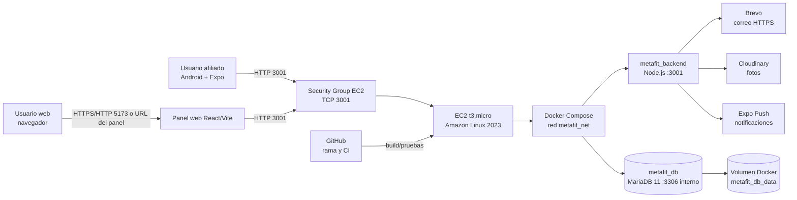

# Arquitectura de despliegue — MetaFit en AWS EC2

**Práctica:** AWS Academy Learner Lab  
**Región:** `us-east-1`  
**Instancia:** EC2 `t3.micro`, Amazon Linux 2023  
**Backend:** Node.js + Express, puerto `3001`  
**Base de datos:** MariaDB 11 en contenedor `metafit_db`, puerto interno `3306`  
**App móvil:** Expo / React Native; consume `EXPO_PUBLIC_API_URL`  
**Fecha:** 2026-11-25  
**Rama:** `feature/sofia-astudillo`

> La IP pública de Learner Lab puede cambiar. En la documentación se usa `<IP_PUBLICA_EC2>`; en la ejecución de referencia se usó `52.90.132.45`. La app móvil toma la URL de `EXPO_PUBLIC_API_URL`.

---

## 1. Diagrama de despliegue



### Vista textual

```text
Navegador / App Android
        |
        | HTTP :3001 (API REST + JWT)
        v
Security Group EC2 (TCP 3001)
        |
        v
EC2 Amazon Linux 2023
  └── Docker Compose (metafit_net)
        ├── metafit_backend  (Node.js, :3001)
        └── metafit_db       (MariaDB 11, :3306 solo interno)
              └── volumen metafit_db_data
```

## 2. Componentes y puertos

| Componente | Imagen / build | Puerto host | Puerto interno | Exposición |
|---|---|---|---|---|
| Backend API | `./backend/Dockerfile` (Node 22) | `3001` | `3001` | Público en el Security Group |
| Base de datos | `mariadb:11` | Ninguno | `3306` | Solo red Docker |
| Volumen de datos | `metafit_db_data` | — | — | Persistente |
| Panel web | React/Vite | `5173` en local | `5173` | No desplegado en la EC2 de la práctica |
| App móvil | Expo/EAS | — | — | Cliente externo |
| Servicios externos | Brevo, Cloudinary, Expo Push | — | — | Salida HTTPS |

## 3. Flujo de despliegue

1. Crear la instancia EC2 y el Security Group.
2. Abrir solo el puerto `3001` para la API (y `22` restringido para SSH).
3. Clonar la rama `feature/sofia-astudillo` en la instancia.
4. Crear `.env` de producción con variables reales; permisos `600`.
5. Ejecutar `docker compose -f deploy/docker-compose.prod.yml up -d --build`.
6. Verificar `metafit_db` healthy y `metafit_backend` activo.
7. Probar `GET http://<IP_PUBLICA_EC2>:3001/health`.
8. Configurar `CORS_ORIGINS` con la URL del panel y orígenes de desarrollo necesarios.
9. Configurar `EXPO_PUBLIC_API_URL=http://<IP_PUBLICA_EC2>:3001` en el entorno de build móvil.
10. Si cambia la IP, actualizar `CORS_ORIGINS`, la app móvil y los enlaces de la documentación.

## 4. Seguridad de red

| Regla | Puerto | Origen | Justificación |
|---|---:|---|---|
| SSH | 22 | IP del administrador | Administración; no abrir a `0.0.0.0/0` |
| API REST | 3001 | `0.0.0.0/0` o IP de evaluación | App móvil y panel web |
| MariaDB | 3306 | Sin regla pública | Solo red Docker |
| HTTP/HTTPS panel | 80/443 | Según hosting del panel | Si se publica el frontend |

Recomendaciones:

- Usar IP elástica para evitar cambios de URL.
- Rotar `DB_PASSWORD` y `JWT_SECRET`; no reutilizar valores de desarrollo.
- No versionar `.env` ni capturas con credenciales.
- Mantener el contenedor de BD sin puerto público.
- Revisar los secretos históricos del repositorio (ver `SECURITY.md`).

## 5. Persistencia y respaldo

- Volumen Docker: `metafit_db_data` → `/var/lib/mysql`.
- Respaldo: `docker exec metafit_db mariadb-dump -u root -p"$DB_PASSWORD" metafit > respaldo.sql`.
- Copia fuera de la instancia: S3, disco cifrado o almacenamiento institucional.
- Restauración: `docker exec -i metafit_db mariadb -u root -p"$DB_PASSWORD" metafit < respaldo.sql`.
- Probar la restauración al menos una vez y registrar fecha, responsable y resultado.

## 6. CI/CD y ramas

- CI actual: `.github/workflows/ci.yml` ejecuta 134 pruebas en Node 20.
- CD actual del repositorio: Render (legado). La práctica vigente es AWS EC2 con despliegue manual documentado.
- Rama de trabajo: `feature/sofia-astudillo`. No se modifica `main` ni el historial.
- Antes de integrar: ejecutar las tres suites y revisar la matriz de pruebas.

## 7. Limitaciones de la práctica

| Limitación | Impacto | Mitigación |
|---|---|---|
| IP pública dinámica | La app deja de conectar si cambia | IP elástica o actualizar `EXPO_PUBLIC_API_URL` y CORS |
| Un solo host EC2 | Sin alta disponibilidad | Respaldo/restauración y aceptación académica |
| Sin balanceador | Un único punto de entrada | Documentar como arquitectura de práctica |
| Sin HTTPS en API | Tráfico sin cifrar | Usar proxy TLS si se expone fuera de la práctica |
| Frontend no desplegado en EC2 | Solo API y BD | Publicar panel aparte o documentar ejecución local |

## 8. Relación con Oracle

Esta rama documenta exclusivamente la práctica AWS EC2 + Docker + MariaDB. **No se modifica ni se elimina la configuración Oracle de `main`**; cualquier referencia a Oracle en el plan de migración es conceptual y no altera esa configuración.

## 9. Archivos relacionados

- `deploy/docker-compose.prod.yml`
- `deploy/.env.prod.example`
- `deploy/RUNBOOK_DESPLIEGUE_EC2.md`
- `documentacion/entregables/Diagrama_de_Despliegue_MetaFit.drawio`
- `documentacion/DIAGRAMAS.md`
- `documentacion/entregables/Manual_de_Instalacion_MetaFit.docx`
- `documentacion/entregables/Manual_Tecnico_MetaFit.docx`
